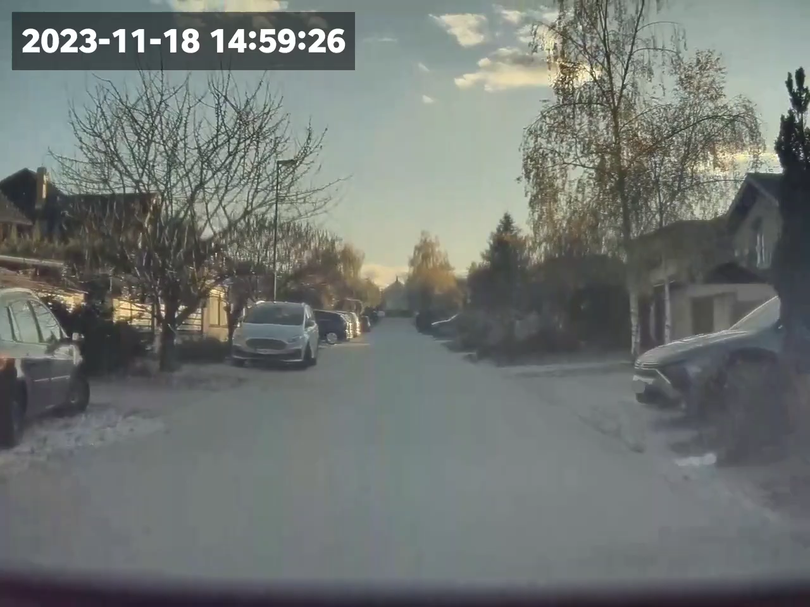
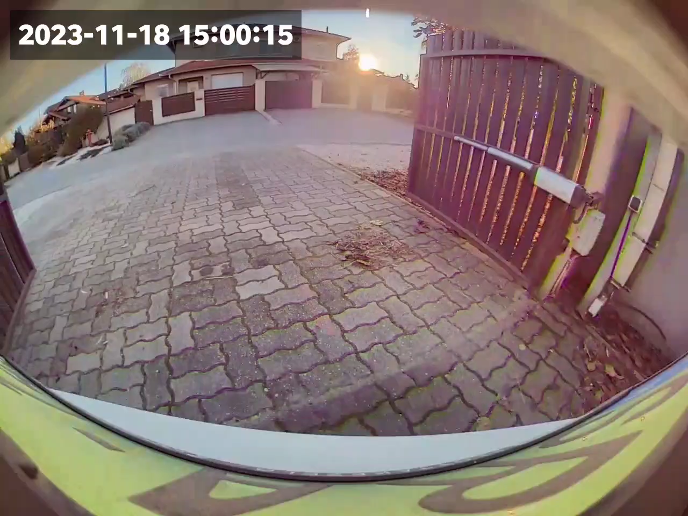
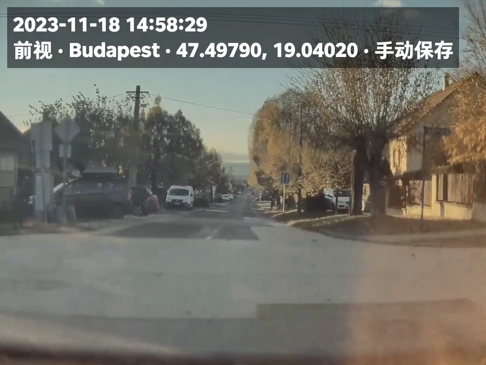
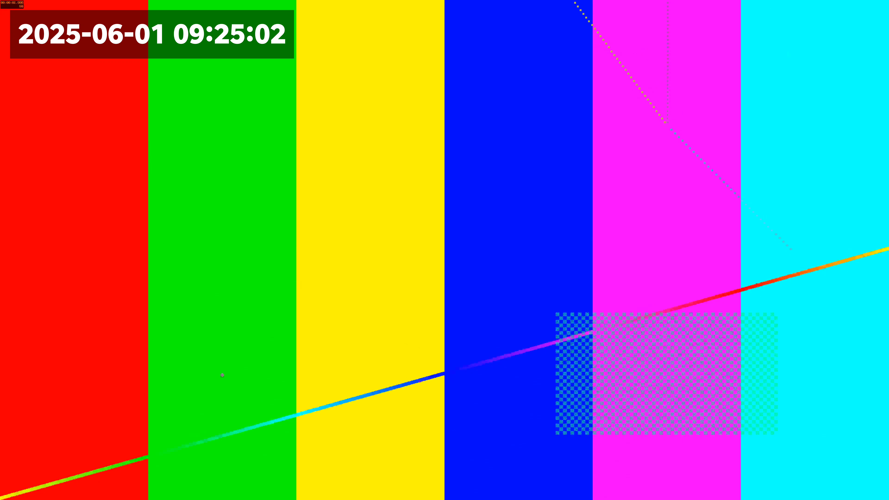

# Tesla 时间戳（Android）

[](https://github.com/hpeng526/tesla-timestamp/actions/workflows/android.yml)

把特斯拉行车记录仪（TeslaCam）U 盘里的视频读出来，**在手机上逐帧把时间戳烧录进画面**，再导出到手机相册。

本项目是仓库根目录两个桌面脚本（`add_timestamp.sh` / `add_timestamp.ps1`）的 Android 重制版：
脚本用 ffmpeg 的 `%{pts:localtime}` 叠加时间，应用则用 MediaCodec + OpenGL ES 在手机上逐帧绘制，
纯本地处理、不依赖 ffmpeg、不需要联网。

| 真实素材输出帧（前视 1s） | 真实素材输出帧（后视 50s） | 带地点信息第二行 |
| --- | --- | --- |
|  |  |  |

---

## 功能

- **读取 U 盘 / TeslaCam 目录**：通过系统文件选择器（SAF）授权 U 盘中的 `TeslaCam`（或 `SavedClips` / `SentryClips` / `RecentClips`）目录，
  自动按片段整理 `front` / `back` / `left_repeater` / `right_repeater` / `left_pillar` / `right_pillar` 视频。
- **解析 event.json**：读取事件时间、城市、经纬度、事件原因（哨兵事件 / 手动保存 / 鸣笛保存…），可作为时间戳第二行显示。
- **逐帧时间戳合成**：时间 = 片段起始时间（取自 `YYYY-MM-DD_HH-MM-SS` 文件名，按手机本地时区）+ 帧 PTS，秒级刷新，与桌面脚本一致。
- **WYSIWYG 预览**：合成前用片段第 1 秒的画面 + 真实字号/位置渲染一张预览图，所见即所得。
- **样式可调**：位置（左上/右上/左下/右下）、字号（小/中/大）、是否显示日期、是否显示摄像头与地点。
- **应用内播放 / 分享**：合成结果直接在应用内播放（循环），也可分享或到相册查看。
- **导出到相册**：写入 `Movies/TeslaTimestamp`（MediaStore），Android 10+ 无需存储权限。
- **批量处理**：一次勾选多个片段/多个摄像头，按顺序处理，可随时取消。
- **深色模式 / 横竖屏 / 中文界面 / 无障碍**：48dp 触控热区、contentDescription、时间用等宽字体。

## 使用步骤

1. 用 **OTG** 把记录仪 U 盘接到手机（系统需要能识别并挂载该 U 盘）。
2. 打开应用，点 **“添加 U 盘 / 文件夹”**，在系统文件选择器里进入 U 盘，选择 `TeslaCam` 文件夹并允许访问。
3. 列表按时间倒序显示片段；点卡片右侧复选框选中整个片段，或点“前视/后视/左后/右后”芯片只选某个摄像头。
4. 点 **“预览”** 确认时间戳的位置与字号。
5. 点 **“合成 N 个视频”**，进度显示 `正在合成 x%`，完成后结果面板可 **播放 / 分享**。
6. 成品保存在相册 `Movies/TeslaTimestamp`，文件名形如 `2024-05-01_13-00-00_front_timestamped.mp4`。

> 也可以点“单个视频”直接选择某一个 mp4；或用“本地路径”扫描应用可访问的目录（调试或先把片段拷到手机时有用）。

## 技术实现

纯原生、无第三方 native 库（不需要 ffmpeg），全部硬件加速：

```
文件（SAF content:// 或 File）
   │  MediaExtractor
   ▼
MediaCodec 解码 ──► SurfaceTexture (OES 纹理)
                        │  EGL + GLES2：视频 blit + Canvas 生成的时间戳纹理叠加
                        ▼
              MediaCodec H.264 硬件编码 (输入 Surface)
                        │
                        ▼
              MediaMuxer（视频重编码 + 音频 AAC 直接拷贝，不二次压缩）
                        │
                        ▼
        MediaStore → 相册 Movies/TeslaTimestamp
```

要点：

- **时间戳纹理**：`Canvas` 按 `textSize = 视频高度 × 5.5% × 字号系数` 绘制白字 + 50% 黑底（等价 ffmpeg `drawtext box=1:boxcolor=black@0.5`），
  每秒只在文本变化时重建一次纹理。
- **时间基准**：`wallClock = 片段起始时间 + decoderPTS`；帧时间通过 `eglPresentationTimeANDROID` 交给编码器，
  保证输出视频的 PTS 与原视频一致（时长、帧率不变）。
- **音频**：压缩帧直接 `writeSampleData` 拷贝，音画同步且不损失音质；无音轨片段自动跳过。
- **旋转视频**：读取 `rotation-degrees`，在 shader 中旋转并交换输出宽高，画面不会歪斜。
- **取消**：后台线程逐帧检查取消标记，取消后删除临时文件，不产生半成品。

### 目录结构

```
app/src/main/java/com/teslacam/timestamp/
├── MainActivity.kt              单 Activity：列表 + 底部操作栏 + BottomSheet（预览/结果/播放）
├── data/
│   ├── TeslaNaming.kt           文件名/目录名时间戳解析（纯 Kotlin，有单测）
│   ├── ClipPath.kt              相对路径 → 片段归属（RecentClips/SavedClips/SentryClips）
│   ├── EventJson.kt             event.json 字段解析（纯 Kotlin，有单测）
│   ├── TeslaCamScanner.kt       SAF DocumentFile / File 目录扫描与分组
│   ├── MediaSource.kt           统一的文件抽象（content:// 与 File）
│   └── TimeFormats.kt           时间/大小格式化
├── media/
│   ├── GlTimestampRenderer.kt   EGL/GLES 渲染器（视频 + 时间戳叠加）
│   ├── TimestampTranscoder.kt   解码→渲染→编码→封装 全流程
│   ├── AudioSampleCopier.kt     音频压缩帧拷贝
│   ├── OverlayBitmapFactory.kt  时间戳位图绘制
│   ├── PreviewComposer.kt       合成前的静态预览
│   └── OverlayStyle.kt          样式与文案
├── export/MediaStoreExporter.kt 导出到相册（MediaStore / 旧版公共目录）
├── ui/                          HeaderAdapter、ClipAdapter、ViewModel、缩略图与播放器
└── usb/UsbInfo.kt               U 盘/可移动存储检测（顶部状态胶囊）
```

## 下载与安装

- **稳定版**：仓库 [Releases](https://github.com/hpeng526/tesla-timestamp/releases) 里的 `tesla-timestamp-vX.Y.Z.apk`
- **最新构建**：Releases 中标记为 Pre-release 的 `latest-build`，每次 push 到 main 自动更新

APK 为 **release 构建**（非 debug）：`applicationId = com.teslacam.timestamp`、`debuggable=false`、
用仓库内固定密钥 `android/keystore/ci.jks` 签名，因此**可以直接覆盖安装升级**，无需卸载。

> 该密钥随仓库公开（密码 `tesla-timestamp-ci`），仅用于这个开源项目的自建分发包。
> 若要上架应用商店或使用自己的密钥，可通过环境变量覆盖：
> `TESLA_KS_PATH` / `TESLA_KS_PASSWORD` / `TESLA_KEY_ALIAS` / `TESLA_KEY_PASSWORD`。

## 构建与安装

环境：JDK 17+、Android SDK（compileSdk 34）。

```bash
cd android
./gradlew :app:assembleDebug          # 产物 app/build/outputs/apk/debug/app-debug.apk
adb install -r app/build/outputs/apk/debug/app-debug.apk
./gradlew :app:testDebugUnitTest      # 单元测试：命名解析、路径归属、event.json、格式化
```

`local.properties` 中需要 `sdk.dir=/path/to/Android/sdk`（该文件不入库）。

## 已做的验证

### 1. 合成素材（自制测试片）

在 Android 手机上完整跑通：

- SAF 授权 `TeslaCam` 目录 → 识别 6 个片段 / 10 个视频，`event.json` 的城市、经纬度、事件原因正确显示；
- 合成后导出到 `Movies/TeslaTimestamp`，用 ffprobe 校验：H.264 1280×720、30fps、时长与原片一致、AAC 音轨保留；
- 抽取成品帧确认时间戳按秒递增（例如 12:35:03、13:00:08），位置/字号/第二行内容与设置一致；
- 无音轨片段可正常合成；批量 10 个视频可一次完成；取消按钮可中断；
- 应用内播放合成结果、深色模式、横竖屏切换均正常。

### 2. 真实 Tesla 行车记录仪素材（Tesla Model 3，HW3）

素材来源：HuggingFace 公开数据集 [tfoldi/tesla3_av_rosbags](https://huggingface.co/datasets/tfoldi/tesla3_av_rosbags)
（Tesla Model 3 + ROS2 采集，`rosbag2_2023_11_18-14_56_27/videos` 内的四路原厂相机视频，
文件名就是 `2023-11-18_14-59-25-front.mp4` 这种 TeslaCam 格式）。

原始素材特征（ffprobe 实测）：

| 项 | 值 |
| --- | --- |
| 分辨率 | 1280×960（4:3，HW3 原厂比例） |
| 帧率 / 编码 | 30fps / H.264 High，约 3.7 Mbps |
| 音频 | **无音轨**（Tesla 行车记录仪视频本身没有声音） |
| 单段时长 | 55～71 秒（整分钟循环写入） |

把 4 路视频放成 `TeslaCam/RecentClips/2023-11-18_14-59-25-{front,back,left_repeater,right_repeater}.mp4`，
再把另一段放成 `TeslaCam/SavedClips/2023-11-18_14-58-24/front.mp4`（含 event.json）后实测：

- 列表显示 2 个片段 / 5 个视频，缩略图为真实街景，4:3 比例正确；
- 预览与成品均为 1280×960，时间戳字号/位置与预览一致（见下图）；
- **批量 4 路（222 秒素材）合成耗时约 22 秒（≈10 倍实时）**，每段 55 秒素材约 5 秒；
- 输出校验：1280×960 / 30fps / **帧数与原片一致**（1676 帧 ↔ 55.867s）/ 无音轨（源无音轨）/ 时长一致；
- 时间戳逐帧递增：1s → 14:59:26，30s → 14:59:55，50s → 15:00:15，60s → 14:59:24（另一段）；
- 打开“摄像头 / 地点”后第二行显示 `前视 · Budapest · 47.49790, 19.04020 · 手动保存`。

> 注：该公开数据集只有视频，没有 Tesla 的 event.json，因此上面第二行的城市/经纬度是用合成 event.json 验证的；
> 真实 U 盘里的 event.json 由车辆写入，字段解析逻辑与上面完全一致。

| 成品帧（前视 1s） | 成品帧（后视 50s） | 成品帧（含地点第二行） |
| --- | --- | --- |
|  |  |  |

> 性能参考：720p30 素材约 5～15 倍实时，1280×960@30fps（HW3 原厂）约 10 倍实时；
> 1 分钟原厂片段约 5～6 秒完成（机型相关）。

### 3. HW4 / AI4 兼容性

HW4（AI4，2023 年起）与 HW3 的差别，以及本应用的对应处理：

| 变化 | 说明 | 应用处理 | 实测 |
| --- | --- | --- | --- |
| **6 路相机** | 新增 `left_pillar` / `right_pillar`（B 柱），文件名与命名规则不变 | 相机名不写死：任意 `*-{camera}.mp4` 都会成为一张可选芯片，已知相机映射中文名（左柱/右柱） | ✅ 6 个芯片全部出现并可单独勾选 |
| **分辨率/码率更高** | HW3 为 1280×960；HW4 传感器像素更高、文件更大 | 按源尺寸编码；超过设备编码上限时逐级等比降级 | ✅ 4096×3072、3840×2160 均正常输出 |
| **编码格式** | 目前固件仍写 H.264/AVC；若未来改 HEVC，解码端跟随源格式 | 解码跟随源 MIME，输出统一 H.264；HEVC 源已验证 | ✅ HEVC 输入 → H.264 输出 |
| **帧率** | 常见 30fps，部分固件 36fps | 帧率取自源格式并写入编码器，不写死 30 | ✅ 36fps 输入输出仍为 36fps |
| **无音轨** | Tesla 记录仪视频本身无声音 | 无音轨自动跳过音频封装 | ✅ |
| **SEI 遥测**（2025.44.25+ 固件） | 新版片段在码流中嵌入速度/GPS 等 SEI 数据 | 重编码会重建码流，SEI 不保留；画面时间戳不受影响 | 说明（该数据不参与合成） |
| **超大素材**（如 5K） | 部分手机解码器内存不足 | 预处理阶段给出明确提示，不产生半成品 | ✅ 提示“分辨率过高或资源不足” |

测试方式：按 HW4 目录结构构造 6 路相机 + HEVC + 4K + 36fps + 5K 素材，在 Android 手机上批量合成：

- 6 路相机（含左右柱）分组正确，芯片可单独勾选；
- 9 个文件批量合成：8 个成功、1 个（5120×3840）失败并给出明确原因，失败项在结果面板列出：
  `前视 · 2025-06-01 09:40:00：设备硬件编解码器处理失败（分辨率过高或资源不足，错误码 1100）`；
- 输出校验：HEVC→H.264、4K 保持 4K、36fps 保持 36fps、时长/帧数与源一致。

| 4K 素材输出帧 |
| --- |
|  |

> 说明：HW4 场景使用符合 HW4 目录/编码特征的自制素材验证（公开渠道没有 HW4 原车片段）；
> 应用由“目录结构 + 文件名 + event.json + 源编码参数”驱动，不依赖具体硬件型号，HW3/HW4 走同一套流程。

## 已知限制

- U 盘必须被系统挂载并出现在系统文件选择器中；部分机型需要在开发者选项里打开 USB 相关开关，或把 U 盘格式化为 exFAT/FAT32。
- 直接读取 `/sdcard/...` 路径受分区存储限制（多数机型应用无法遍历该目录），因此默认走 SAF，这也是把“文件选择器”作为主入口的原因。
- 音频是直接拷贝压缩帧，如果原片音轨不是 AAC（极少数）会退化为静音输出视频；特斯拉原厂文件是 AAC，不受影响。
- 4K 素材在低端机上可能较慢（编码码率上限 24 Mbps）。

## Roadmap

- 多摄像头画面拼接（2×2 同步合成）。
- 叠加速度 / 轨迹（Tesla 只在 event.json 写单点坐标）。
- 导出后可选清理源片段。
- 后台任务 + 前台通知（长时间批量合成）。

## 设计说明

UI 参考 [mustafakendiguzel/claude-code-ui-agents](https://github.com/mustafakendiguzel/claude-code-ui-agents) 中的移动端设计方法论：
8pt 间距体系、三级字号层级、Brand 色阶、Bottom Sheet 承载模态操作、48dp 触控热区、微交互（点击反馈 / 缩略图淡入 / 进度条）、深色模式与对比度校验。
详见 [docs/DESIGN.md](docs/DESIGN.md)。